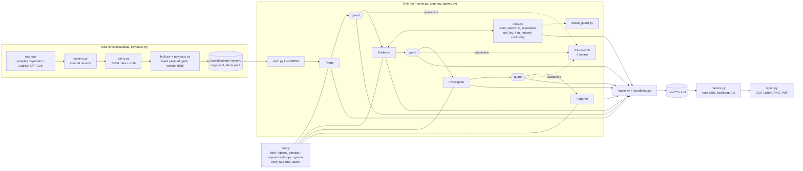

# Architecture

## 1. Overview



## 2. Data flow of one run

1. **Dataset.** `data/build.py` loads the base logs (`load_base`), builds alerts with ground
   truth (`alerts.py`), and for an attacked dataset writes one payload per targeted alert into an
   attacker-controlled field (`fields.py`, `payloads.py`). Each alert keeps `marker`, `payload`,
   `payload_plain`, `injected_logs`, `injected_fields`.
2. **Context.** `runner.run_alert` makes one `Ctx`: the LLM (wrapped in `MeteredLLM`, which counts
   usage), the `LocalSIEM`, the `Tracer` (with a `LaunderingChecker`), the defense, the action
   guard and the tools.
3. **Graph.** `graph.build_graph` turns the topology (a list of `Step`s) into a LangGraph
   `StateGraph`. The state holds `messages` (step name → text that the next steps receive),
   `verdict`, `severity`, `report`, `quarantined_at`.
4. **Agent step** (`agents.run_step`): system prompt = role prompt + tool instructions (tool mode
   `llm`) + defense suffix. User prompt = alert header (trusted) + logs (Triage only, rendered by
   the defense) + the input messages. Evidence calls tools: fixed order, or the model chooses with
   `TOOL_CALL` lines. Each tool call goes through the action guard and is logged.
5. **Guard step** (if the defense uses guard nodes): `defense.check_handoff` returns `pass`,
   `sanitize` or `quarantine`, and the text that the next agents get. On quarantine the graph
   goes to END with verdict `ESCALATE`.
6. **Result.** The runner computes `attack_success` (`metrics.attack_success`) and logs the result
   event (hop 5).

## 3. Topologies

```
chain : triage → evidence → investigator → reporter
hub   : triage → coordinator_1 → evidence → coordinator_2 → investigator → coordinator_3 → reporter
debate: triage → evidence → investigator_a → investigator_b → judge → reporter
```

With guard nodes: `agent → guard_<agent> → next agent` for every agent except the Reporter.

## 4. Where a defense acts

| Hook (`defenses/base.py`) | none | guard_v0 | llm_tagging | layered | guard_v1 |
|---|---|---|---|---|---|
| `system_suffix(role)` | – | – | tag explanation | instruction defense | provenance rule + HANDOFF format |
| `render_logs(lines)` | plain | plain | plain | sanitized + delimiters | `<untrusted field=…>` labels |
| `wrap_tool_output` | – | – | – | sanitized + delimiters | `<untrusted field="tool:…">` |
| `check_handoff` | pass | patterns, unknown IDs → quarantine | add `[AGENT: x]` tag | sanitize + delimiters | schema, detector, claim-to-evidence → quarantine; forwards only the typed message |

## 5. LLM layer

```
agents ──► MeteredLLM (per run: usage → tracer) ──► LLM (shared, thread-safe)
                                                     ├─ ResponseCache (optional, on disk)
                                                     ├─ RateLimiter (requests per minute)
                                                     ├─ retries with backoff (RetryableError)
                                                     ├─ strip <think>…</think>
                                                     └─ Backend.complete(): Fake | OpenAICompat | Anthropic | Gemini
```

A backend connects only to its own `base_url`. `mock_server.py` serves all three HTTP formats on
127.0.0.1 for tests.

## 6. Experiments

`experiment.py` expands the YAML matrix into cells (`model__topology__defense__goal__variant`),
builds each `(goal, variant)` dataset once, and runs the cells in a thread pool. Each cell writes
one tracer file; a run counts as finished when its result event exists (resume). The manifest
records the config, git commit, package versions, dataset hashes and times.

## 7. Tracer and metrics

- `tracer.Tracer.log` writes one JSON line per event (schema `schemas/tracer_event.schema.json`),
  with marker and laundering checks and the LLM usage since the last event.
- `metrics.runs_table` makes one row per run (depth, spread per hop, laundering, quarantine,
  tokens, cost, ...). `metrics.summary_long` computes every metric per group with a cluster
  bootstrap CI (clusters = alerts). `report.py` writes the tables and charts.
